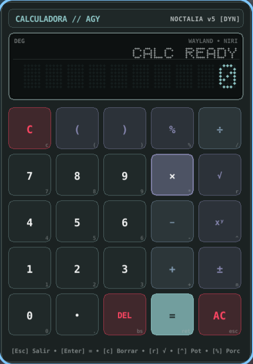

# 󰪚 Calculadora AGY

Una calculadora moderna construida en **Rust** diseñada especialmente para entornos **Wayland** y el compositor **Niri**, con integración dinámica de colores para **Noctalia v5** y una estética minimalista estilo **btop++ / terminal**.



## ✨ Características

- 📟 **Pantalla Retro LCD Dot-Matrix:**
  - Renderizado pixel a pixel con simulación de pantalla LCD/VFD clásica.
  - Matriz de puntos atenuados visibles de fondo (simulando los cristales líquidos físicos no encendidos).
  - Puntos activos brillantes en el color de acento primario con halo de resplandor (*glow*).
  - Fila superior para historial de expresiones y fila principal para entrada/resultado.

- 🎨 **Estética btop++ y Transparencia Wayland:**
  - Fondo con canal alfa translúcido (~80% opacidad) que deja entrever el fondo de pantalla con blur en compositores como Niri.
  - Marcos, bordes y etiquetas con tipografía monoespaciada limpia.
  - Botones interactivos con resaltado al pasar el ratón (*hover*) y estado activo al hacer clic.

- 🔄 **Integración Dinámica con Noctalia v5:**
  - Extrae y genera automáticamente la paleta de colores activa usando la CLI y configuración de Noctalia (`settings.toml`).
  - Hilo en segundo plano que detecta en tiempo real los cambios de fondo de pantalla o esquema en Noctalia y actualiza los colores de la calculadora al vuelo sin necesidad de reiniciarla.
  - Soporte de modo Oscuro / Claro.

- 📐 **Integración Nativa con Niri:**
  - Configurado con `app-id = "calculadora-agy"`.
  - Regla de ventana incluida en `~/.config/niri/cfg/rules.kdl` para que se abra automáticamente de forma **flotante** centrada (`open-floating true`) con tamaño predeterminado óptimo (`390x560`).

- 🧮 **Operaciones Matemáticas:**
  - Operaciones básicas: Suma (`+`), Resta (`-`), Multiplicación (`*`), División (`/`).
  - Paréntesis anidados: `(`, `)`.
  - Potencias: `^` (ej. `2 ^ 8 = 256`).
  - Raíz cuadrada: `√` (ej. `√(144) = 12`).
  - Porcentajes: `%` (ej. `200 * 15% = 30`, `50% = 0.5`).
  - Cambio de signo: `±`.
  - Historial y evaluación continua de expresiones complejas respetando la jerarquía de operadores (PEMDAS).

## ⌨️ Atajos de Teclado

| Tecla | Acción |
| :--- | :--- |
| `0` - `9`, `.` | Entrada de dígitos y punto decimal |
| `+`, `-`, `*`, `/` | Operadores aritméticos |
| `^` | Potenciación |
| `r` o `v` | Raíz cuadrada (`√`) |
| `%` | Porcentaje |
| `(` y `)` | Paréntesis |
| `Enter` o `=` | Calcular resultado |
| `Backspace` | Borrar último carácter (`DEL`) |
| `c` / `C` | Borrar expresión actual (`C`) |
| `Delete` | Borrar todo incluyendo historial (`AC`) |
| `Esc` o `q` | Salir de la calculadora (o limpiar si hay texto) |

## 🚀 Instalación y Ejecución

El binario optimizado ya se encuentra compilado e instalado en `~/.local/bin/calculadora-agy`.

```bash
# Ejecutar directamente desde la terminal o lanzador de aplicaciones (dmenu, fuzzel, rofi, Noctalia launcher):
calculadora-agy
```
